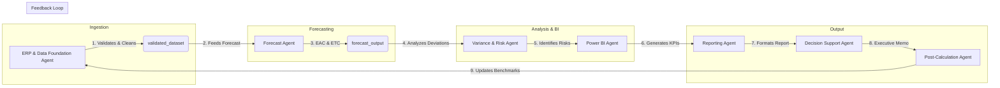

# 📊 Project Finance AI Controller

A multi-agent, local-first operational data orchestration pipeline and interactive dashboard for project finance management. This system processes raw transactional ERP data, calculates project forecasts (EAC/ETC), analyzes variances, and identifies risk elements using specialized agent modules.

---

## 🏗 Architecture & Agent Workflow

The project utilizes an agentic workflow where each agent has a clear responsibility and communicates through a shared SQLite database:



For full details on the workflow, see the [Agent Workflow Documentation](docs/architecture/agent_workflow.md).

---

## 📁 Repository Structure

```text
├── agents/                       # Specialized AI agent implementations
│   ├── erp_data_foundation/      # Data cleaning and validation
│   ├── forecast/                 # EVM metrics (EAC, ETC, CPI, SPI)
│   ├── variance_risk/            # Cost overruns & risk grading
│   ├── power_bi/                 # Business logic and DAX generation
│   ├── reporting_standardization/# Report compilation templates
│   ├── decision_support/         # Alternative option evaluations
│   └── calc_postcalc/            # Post-calc and parameter feedback loop
├── data/
│   └── project_finance.db        # SQLite database populated with mock data
├── docs/                         # System documentation and diagrams
│   ├── architecture/             # Workflow diagrams and designs
│   ├── data_models/              # Entity relation schemas
│   └── user_guide.md             # Complete user guide
├── mock_data/                    # CSV raw copies of the mock datasets
├── tests/                        # Unit test suite for validation
├── app.py                        # Interactive Streamlit dashboard UI
├── index.html                    # Static dashboard for hosting via GitHub Pages
└── simulate_pipeline.py          # CLI multi-agent simulation orchestrator
```

> [!NOTE]
> The repository is set up with GitHub Pages at **https://frank-ellingsen.github.io/project-finance-ai/**, serving the interactive static `index.html` dashboard directly.

---

## 🚀 Quick Start

### 1. Prerequisites
Make sure you have **Python 3.10+** installed.

### 2. Install Dependencies
```powershell
pip install -r requirements.txt
```

### 3. Run Pipeline Ingestion (CLI Simulation)
To run the end-to-end agentic workflow in your console:
```powershell
python simulate_pipeline.py
```

### 4. Run the Streamlit Dashboard
Launch the interactive web UI:
```powershell
streamlit run app.py
```

---

## 🗄️ Database & Schema

The underlying SQLite database `project_finance.db` is organized around time-phased composite keys `(project_id, period)`. For details on fields and visual illustrations, refer to the [Schema Relation Map](docs/data_models/schema_relation.md).

---

## 🧪 Testing

Run the automated unit tests to evaluate agent integrity:
```powershell
python -m unittest discover -s tests -p "test_*.py"
```
