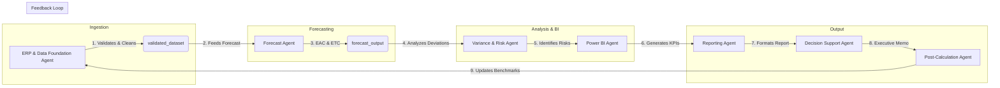

# Project Finance AI: Multi-Agent Workflow

This document describes the end-to-end multi-agent orchestration workflow within the `project-finance-ai` system.

## Workflow Steps & Agent Responsibilities

### 1. ERP & Data Foundation Agent
* **Input**: Raw transaction files/databases (`erp_raw_data`).
* **Process**: Checks for formatting errors, mismatched records, and missing values.
* **Output**: A standardized `validated_dataset`.

### 2. Forecast Agent
* **Input**: Standardized project actuals and current budget allocations.
* **Process**: Computes Earned Value Management (EVM) metrics including Estimate at Completion (EAC) and Estimate to Complete (ETC) costs/hours.
* **Output**: `forecast_output` and `rolling_forecast`.

### 3. Variance & Risk Agent
* **Input**: Validated dataset and forecast packages.
* **Process**: Compares planned vs. actuals vs. forecasted margins, isolates primary cost overrun drivers, and flags risk levels.
* **Output**: `variance_risk_report`, `variance_drivers`, and `risk_items`.

### 4. Power BI Agent
* **Input**: Forecast and variance report metadata.
* **Process**: Automates DAX calculation generation and maps visual model relationships.
* **Output**: `powerbi_kpis`.

### 5. Reporting Agent
* **Input**: Structured agent calculations.
* **Process**: Translates raw data into a clean, markdown-based standardized template format.
* **Output**: `standardized_report`.

### 6. Decision Support Agent
* **Input**: Standardized report details.
* **Process**: Evaluates action alternatives (e.g., adding resources vs. reducing scope) and issues recommended choices.
* **Output**: `decision_support` (Executive Memos).

### 7. Calculation & Post-Calc Agent
* **Input**: Historical performance vs. original bidding calculations.
* **Process**: Runs after-action reviews to identify why cost overruns happened.
* **Output**: `lessons_learned` and `suggested_updates`, which feed back into the bidding model to adjust parameters for future projects.
