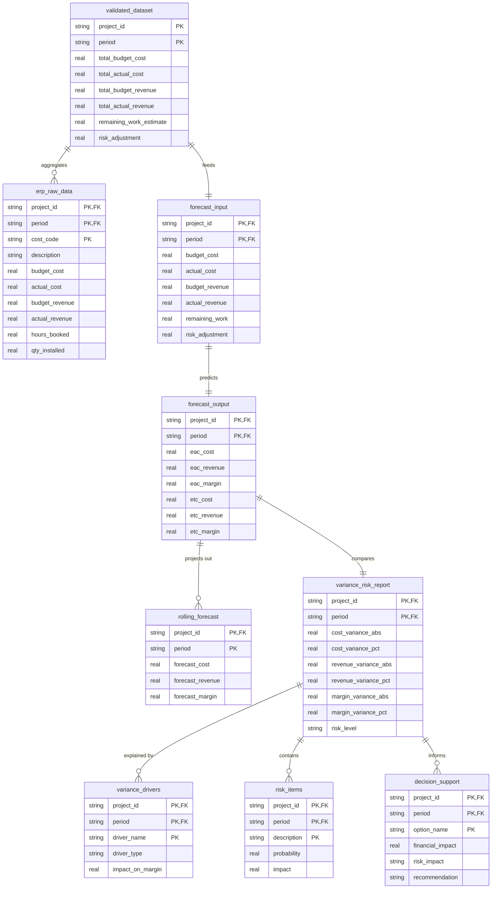

# SQLite Database Schema Relation Map

This document outlines the entity relationships and schema details for `project_finance.db` used in the Project Finance AI agentic workflow.

## Entity Relationship Diagram

## Primary Key Mapping & Relations

Most tables in the project finance database use a composite key consisting of `(project_id, period)` to uniquely identify data rows in time-phased project management:

| Table | Composite Keys / Identifiers | Type | Relationship / Description |
|---|---|---|---|
| `validated_dataset` | `(project_id, period)` | Fact (Cleaned) | Parent record for a project's monthly period reporting. |
| `erp_raw_data` | `(project_id, period, cost_code)` | Fact (Raw) | Many-to-one with `validated_dataset` via `(project_id, period)`. |
| `forecast_input` | `(project_id, period)` | Input Parameter | One-to-one with `validated_dataset`. |
| `forecast_output` | `(project_id, period)` | Calculation Output | One-to-one with `forecast_input`. |
| `rolling_forecast` | `(project_id, period)` | Future Projections | One-to-many from `forecast_output` for future periods. |
| `variance_risk_report`| `(project_id, period)` | Analysis Output | One-to-one with `forecast_output`. |
| `variance_drivers` | `(project_id, period, driver_name)`| Drivers Breakdown | Many-to-one with `variance_risk_report`. |
| `risk_items` | `(project_id, period, description)`| Risk Registry | Many-to-one with `variance_risk_report`. |
| `decision_support` | `(project_id, period, option_name)`| Decision Alternatives| Many-to-one with `variance_risk_report`. |

## Reference & Configuration Tables

The following tables are standalone lookups or configuration data without direct relational foreign keys:

- `powerbi_kpis`: Contains business logic specifications (`kpi_name`, `dax_expression`) for the Power BI Agent.
- `standardized_report`: Configuration table mapping the output sections to fields (`section`, `field`).
- `postcalc_comparison`: Cost structure evaluation metrics (`item`, `bid_value`, `actual_value`, `variance`).
- `lessons_learned`: Text observations of project failures/successes (`lesson`).
- `suggested_updates`: Parameter adjustment suggestions (`update`) fed back to the bidding/ERP systems.
